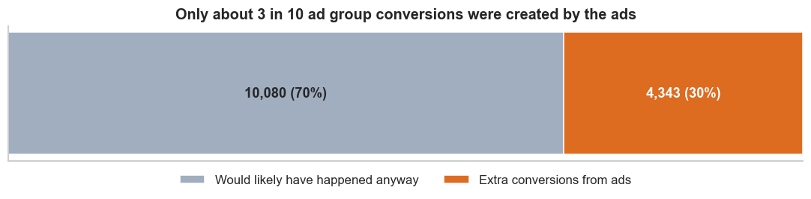
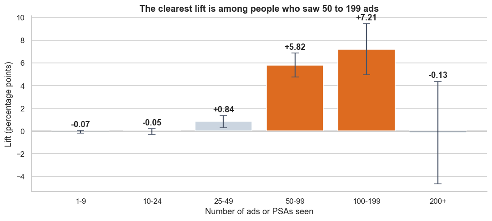

# Marketing A/B Test: Did the Ads Work?

Should a company keep paying for an ad campaign, and how could it spend better? This project analyses an A/B test of 588,101 users, comparing people who saw ads with people who saw public service announcements (PSAs).

**Tools:** Python (pandas), SQL (SQLite), Matplotlib

**[View the full analysis notebook](marketing_ab_test.ipynb)**

## Key findings

- **The ads worked:** 2.55% of the ad group converted, compared with 1.79% of the PSA group. That's 0.77 percentage points higher (likely range 0.60 to 0.94).
- **Most conversions would have happened anyway:** about 70% of the ad group's conversions would likely have happened without ads.
- **The ads created about 4,300 extra conversions:** that's 1 extra conversion for about every 3,200 ads shown.
- **The extra conversions are concentrated:** users who saw 50 to 199 ads make up about 88% of the estimated extra conversions.





## Business questions

1. Did the ads increase conversions?
2. How many conversions did the ads really create?
3. How much advertising does each extra conversion take?
4. Where did the ads make the biggest difference?

## Recommendations

1. **Keep the campaign if an extra conversion is worth more than it costs.** At an example price of $5 per 1,000 ads, an extra conversion costs about $16. Use real costs here.
2. **Report extra conversions, not total conversions.**
3. **Test a limit of 200 ads per person.** 13% of ads went to 1% of users, with no clear lift.
4. **Test whether reaching 50 ads helps lighter viewers.** Lift is clearest at 50 to 199 ads, but those users may simply be more active.

## Data

The data is [Marketing A/B Testing](https://www.kaggle.com/datasets/faviovaz/marketing-ab-testing) from Kaggle. It has one row per user: their group, whether they converted, how many ads or PSAs they saw, and the day and hour they saw the most.

| Check | Result |
|---|---|
| Users | 588,101 |
| Ad group | 564,577 (96%) |
| PSA group | 23,524 (4%) |
| Missing values | 0 |
| Repeated users | 0 |
| Average ads or PSAs seen | 24.8 in both groups |

The CSV isn't in this repository, so download it from Kaggle to run the notebook.

## Method

1. **Check the data:** looked for missing values, repeated users and differences between the groups.
2. **Compare the groups:** used SQL for conversion rates, then calculated the difference, its likely range and whether it could be chance.
3. **Estimate extra conversions:** compared the ad group's conversions with what it would have had at the PSA group's rate.
4. **Work out the advertising needed:** divided ads shown by extra conversions.
5. **Look for where to test next:** compared the groups by number of ads seen, and checked whether the day mix changed the result.

## Limitations

- **No costs or revenue:** the data can't show profit, and the cost figures are examples.
- **Only the group was randomly assigned:** the overall lift is the strongest result. Results by number of ads or day suggest what to test next, but don't prove cause.
- **Unknown details:** the data doesn't say what the product was, what counts as a conversion, or when the campaign ran.
- **Data source:** this is a public Kaggle dataset, so I can't independently confirm how the test was run.
- **PSA users saw something too:** the comparison is ads vs PSAs, not ads vs nothing.

## Repository structure

```text
├── marketing_ab_test.ipynb   # Full analysis, with outputs
├── figures/                  # Charts
├── outputs/                  # Result tables
├── requirements.txt
└── README.md
```

## Run it yourself

1. Install the dependencies:

   ```bash
   pip install -r requirements.txt
   ```

2. Download `marketing_AB.csv` from [Kaggle](https://www.kaggle.com/datasets/faviovaz/marketing-ab-testing) and put it next to the notebook.

3. Open the notebook and run all cells:

   ```bash
   jupyter notebook marketing_ab_test.ipynb
   ```

## Author

**Lilit Poghosyan**
