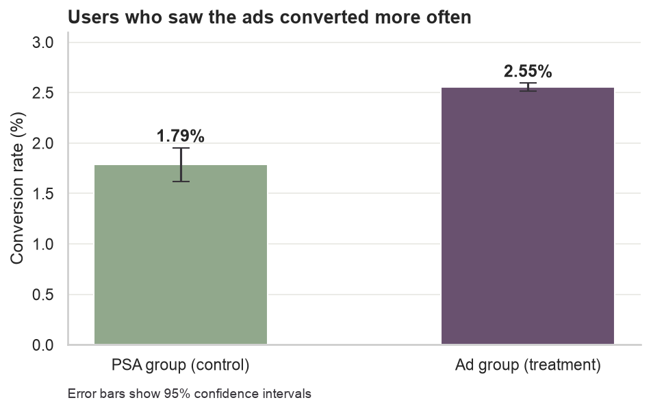
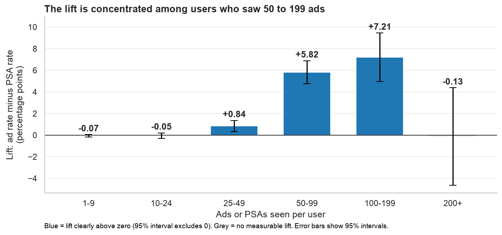

# Marketing A/B Test Analysis: Did the Ad Campaign Work?

An end-to-end analysis of a marketing A/B test with 588,101 users: from data checks and exploratory analysis to a statistical test, business impact and recommendations.

**Tools:** Python (pandas, NumPy, SciPy, statsmodels), SQL (SQLite), Matplotlib, Seaborn, Jupyter Notebook

**[Open the full analysis notebook](marketing_ab_test_analysis.ipynb)**

## Business problem

A company runs an online ad campaign and wants to know whether it is worth the money. Counting how many ad viewers bought the product is misleading, because many of them would have bought anyway. To measure the true effect, the company ran an A/B test:

- **Ad group (treatment, 96% of users):** saw the company's ads.
- **PSA group (control, 4% of users):** saw a public service announcement in the same ad slot, so both groups had the same experience apart from the commercial ad.

**The decision to support:** should the company keep paying for this campaign, and how could it spend the budget better?

**Questions answered in this project**

1. Did the ads increase conversions, and is the difference statistically significant?
2. How many additional conversions did the ads generate?
3. How many ads were needed to generate each additional conversion?
4. Where did the ads make the biggest difference?

**Success metric:** conversion rate = users who converted ÷ users in the group.

**Hypotheses** (significance level α = 0.05)

- **H₀:** the conversion rate is the same in the ad group and the PSA group.
- **H₁:** the conversion rate is different in the two groups.

## Key findings

| Question | Answer |
|---|---|
| Did the ads work? | **Yes.** 2.55% of the ad group converted vs 1.79% of the PSA group: +0.77 percentage points (95% CI 0.60 to 0.94), a 43% relative lift (95% CI 30% to 58%), p < 0.001 |
| How many conversions did the ads create? | About **4,343 extra conversions** (95% CI 3,360 to 5,326). Around 70% of the ad group's 14,423 conversions would likely have happened anyway |
| How much advertising per extra conversion? | About **3,227 ad impressions** (95% CI about 2,600 to 4,200) |
| Where is the effect? | Users who saw **50 to 199 ads** account for about 88% of the estimated extra conversions, from 11% of ad users and 38% of impressions. No measurable lift below 25 ads (72% of the ad group) or above 200 ads |






### Lift by number of ads seen

Ad users are compared with PSA users inside the same exposure band, which removes most of the "active users see more ads and buy more anyway" effect.

| Ads seen | Share of ad users | Ad rate | PSA rate | Lift (points) | Measurable lift? |
|---|---|---|---|---|---|
| 1-9 | 42% | 0.31% | 0.38% | -0.07 | No |
| 10-24 | 30% | 0.95% | 0.99% | -0.05 | No |
| 25-49 | 16% | 3.35% | 2.51% | +0.84 | Yes |
| 50-99 | 8% | 11.35% | 5.53% | +5.82 | Yes |
| 100-199 | 3% | 17.74% | 10.53% | +7.21 | Yes |
| 200+ | 1% | 15.57% | 15.71% | -0.13 | No (only 261 PSA users, so the estimate is uncertain) |

### Is the result robust?

- **Two tests agree:** the two-proportion z-test (z = 7.37) and the chi-square test give the same p-value.
- **Simulation:** redrawing both groups 10,000 times gives the same interval as the formula (0.60 to 0.94 points), and the ad group wins in every run.
- **Sensitivity:** the test could reliably detect a lift of about 0.25 points. The observed lift is three times larger, so the small control group is not a concern for the headline result.
- **Day of week:** the ad group converts more on all 7 days, and the lift adjusted for the day mix (0.78 points) matches the headline result (0.77).

## Recommendations

1. **Check whether the campaign makes money.** Keep advertising only if one extra conversion is worth more than the cost of about 3,200 impressions. At an example price of $5 per 1,000 impressions that is about $16 per extra conversion. The company should plug in its real costs and margin.
2. **Count only the extra purchases generated by advertising.** Some users would have bought anyway, so total conversions overstate the campaign by more than three times.
3. **Keep a control group.** Continuing to show PSAs to a small group of users is the only way to measure what the ads add.
4. **Test limiting the number of ads to 200 per user.** 1% of users receive 13% of impressions with no measurable lift. A cap would save about 5% of impressions.
5. **Test showing more ads to users who see very few.** The lift is strongest at 50 to 199 ads, so the company could test whether raising exposure for users who currently see fewer than 25 ads leads to more purchases. Heavy viewers may simply be more active users, so this needs a randomised test.

## Dataset

[Marketing A/B Testing](https://www.kaggle.com/datasets/faviovaz/marketing-ab-testing) from Kaggle. One row per user.

| Column | Meaning |
|---|---|
| `user id` | Unique user identifier |
| `test group` | `ad` (saw the ads) or `psa` (saw the public service announcement) |
| `converted` | `True` if the user bought the product |
| `total ads` | Number of ads or PSAs the user saw |
| `most ads day` | Day of the week on which the user saw the most ads |
| `most ads hour` | Hour of the day (0 to 23) in which the user saw the most ads |

| Data check | Result |
|---|---|
| Users | 588,101 |
| Ad group / PSA group | 564,577 (96%) / 23,524 (4%) |
| Missing values | 0 |
| Duplicated users | 0 |
| Invalid values (ads, hours, days, labels) | 0 |
| Average ads or PSAs seen | 24.8 in both groups (median 13 vs 12) |
| Rows removed during cleaning | 0 |

## Approach

1. **Data quality checks and cleaning:** missing values, duplicates, invalid values, column names and types.
2. **Exploratory data analysis:** group sizes, distribution of ads seen, conversion by exposure, day and hour, and whether the two groups are comparable.
3. **A/B test:** conversion rates pulled with SQL, two-proportion z-test, chi-square test, 95% confidence intervals for the absolute and relative lift, a simulation check and the minimum detectable effect.
4. **Business impact:** incremental conversions and impressions per extra conversion, with example cost scenarios.
5. **Breakdown:** lift by number of ads seen (ad vs PSA within the same exposure band) and a check that the result holds across days of the week.
6. **Recommendations, limitations and next steps.**

## Limitations

- **No cost or revenue data:** the analysis measures extra conversions, not profit or ROI. Cost figures are examples.
- **Only the group was randomised:** the overall lift is the strongest result. Breakdowns by exposure, day and hour are observational: they suggest what to test next but do not prove cause.
- **Small control group:** 4% is enough for the headline result but makes segment-level estimates (for example 200+ ads or single days) less precise.
- **Missing context:** the data does not say what the product is, what counts as a conversion, when the campaign ran or how users were assigned. Because the planned split is unknown, a sample-ratio check is not possible.
- **Ads vs PSA, not ads vs nothing:** the control group still saw something in the ad slot.
- **Public dataset:** how the experiment was run cannot be independently confirmed.

## Next steps

1. Add cost per impression and revenue per conversion to calculate ROI.
2. Run the frequency cap (recommendation 4) as a properly randomised experiment.
3. Use a larger control group (for example 10%) in the next test so segment results are more precise.
4. Collect conversion timestamps to study how long after exposure users convert.

## Repository structure

```text
├── marketing_ab_test_analysis.ipynb   # Full analysis with outputs
├── figures/                           # 8 charts saved by the notebook (PNG)
├── outputs/                           # Result tables saved by the notebook (CSV)
│   ├── ab_test_summary.csv            # Headline metrics
│   ├── lift_by_exposure.csv           # Lift by number of ads seen
│   └── lift_by_day.csv                # Lift by day of week
├── requirements.txt                   # Python packages
└── README.md
```

## How to run it

1. Download `marketing_AB.csv` from [Kaggle](https://www.kaggle.com/datasets/faviovaz/marketing-ab-testing) and put it in this folder, next to the notebook. The file is not included in the repository.

2. Install the packages (they are already included in a standard Anaconda installation):

   ```bash
   pip install -r requirements.txt
   ```

3. Open the notebook in Jupyter (from Anaconda Navigator, or from a terminal) and choose **Kernel → Restart & Run All**:

   ```bash
   jupyter notebook marketing_ab_test_analysis.ipynb
   ```

## Author

**Lilit Poghosyan**
