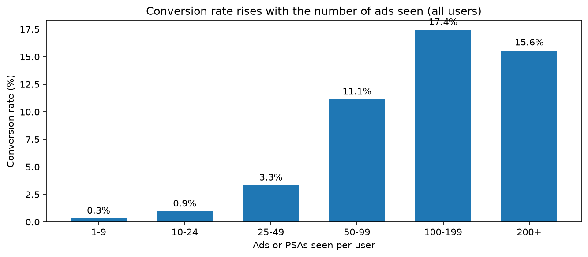

# Marketing A/B Test Analysis: Did the Ad Campaign Work?

An end-to-end analysis of a marketing A/B test with 588,101 users: from data checks and exploratory analysis to a statistical test, business impact and recommendations.

**Tools:** Python (pandas, NumPy, SciPy, statsmodels), SQL (SQLite), Matplotlib, Jupyter Notebook


## Business problem

A marketing team spends budget on an online ad campaign and wants to know whether it is worth the money. Counting how many ad viewers bought the product is misleading, because many of them would have bought anyway. To measure the true effect, the company ran an A/B test:

- **Ad group (treatment, 96% of users):** saw the company's ads.
- **PSA group (control, 4% of users):** saw a public service announcement in the same ad slot, so both groups had the same experience apart from the commercial ad.

**The decision to support:** should the company keep paying for this campaign, and how could it spend the budget better?

**Business questions**

1. Did the ads increase conversions, and is the difference statistically significant?
2. How many additional conversions did the ads generate?
3. How many ads were needed to generate each additional conversion?

**Success metric:** conversion rate = users who converted ÷ users in the group.

**Hypotheses** (significance level α = 0.05)

- **H₀:** the conversion rate is the same in the ad group and the PSA group.
- **H₁:** the conversion rate is different in the two groups.

## Key findings

| # | Question | Answer |
|---|---|---|
| 1 | Did the ads increase conversions? | **Yes.** The ad group converted at 2.55%, compared with 1.79% for the PSA group. The difference is 0.77 percentage points (95% CI 0.60 to 0.94), a 43% relative lift (95% CI 30% to 58%), p < 0.001 |
| 2 | How many additional conversions did the ads generate? | About **4,343** (95% CI 3,360 to 5,326), around 30% of the ad group's 14,423 conversions. The other 70% would likely have happened anyway |
| 3 | How much advertising per additional conversion? | About **3,227 ad impressions** (14,014,701 impressions shown ÷ 4,343 extra conversions) |


### Statistical test

| Measure | Result |
|---|---|
| Two-proportion z-test | z = 7.37, p = 1.7e-13 |
| Chi-square test (cross-check) | chi2 = 54.3, p = 1.7e-13 |
| Decision at α = 0.05 | Reject H₀: the conversion rates differ |

Both tests give the same p-value. The confidence intervals of the two groups do not overlap, and the PSA group's interval is wider because that group is smaller.

### What the exploratory analysis showed

- **Uneven split:** 564,577 users (96%) were in the ad group and 23,524 (4%) in the PSA group. Conversion is a rare event: 2.52% of all users converted.
- **Skewed exposure:** half of all users saw 13 ads or fewer, while the average was 25 and the maximum 2,065. The top 1% of users (more than 202 ads) received 13% of all impressions.
- **Conversion rises with exposure:** from 0.3% among users who saw fewer than 10 ads to about 17% among users who saw 100 to 199. This is an observational relationship, not evidence that more ads cause more purchases: more active users may both see more ads and be more likely to buy.



## Recommendations

1. **Evaluate campaign profitability.** Compare the value of the estimated additional conversions with actual advertising costs before deciding whether to continue or expand the campaign.
2. **Measure incremental conversions.** Do not attribute every purchase made by someone who saw an ad to the campaign. Counting all 14,423 conversions would overstate the campaign by more than three times.
3. **Maintain a control group.** Keep showing PSAs to a control group to measure the performance of future campaigns.
4. **Improve future experiments.** Document the randomisation process and collect advertising cost, revenue and conversion timing data.

## Dataset

[Marketing A/B Testing](https://www.kaggle.com/datasets/faviovaz/marketing-ab-testing) from Kaggle. One row per user.

| Column | Meaning |
|---|---|
| `user id` | Unique user identifier |
| `test group` | `ad` (saw the ads) or `psa` (saw the public service announcement) |
| `converted` | `True` if the user bought the product |
| `total ads` | Number of ads or PSAs the user saw |
| `most ads day` | Day of the week on which the user saw the most ads |
| `most ads hour` | Hour of the day (0 to 23) in which the user saw the most ads |

| Data check | Result |
|---|---|
| Users | 588,101 |
| Ad group / PSA group | 564,577 (96%) / 23,524 (4%) |
| Missing values | 0 |
| Duplicated rows or user ids | 0 |
| Invalid values (ads, hours, days, labels) | 0 |
| Rows removed during cleaning | 0 |

The only cleaning needed was dropping the row counter column, renaming the columns, turning `converted` into 1/0 and putting the days in calendar order.

## Approach

1. **Data quality checks and cleaning:** missing values, duplicates, invalid values, column names and types.
2. **Exploratory data analysis:** group sizes, distribution of ads seen and conversion rate by number of ads seen.
3. **A/B test:** conversion rates pulled with SQL, two-proportion z-test, chi-square test as a cross-check, and 95% confidence intervals for the absolute difference and the relative lift.
4. **Business impact:** incremental conversions and ad impressions per additional conversion.
5. **Conclusions, recommendations, limitations and next steps.**

## Limitations

- **No cost or revenue data:** the analysis estimates additional conversions but cannot calculate campaign profit or ROI.
- **Unknown randomisation process:** the dataset does not explain how users were assigned to the two groups, so the experiment design cannot be independently verified.
- **Small control group:** the PSA group is only 4% of users, which makes its conversion-rate estimate less precise.
- **Missing context:** the dataset does not specify the product, the exact definition of a conversion or the campaign period.
- **Ads vs PSA, not ads vs nothing:** the control group still saw something in the ad slot.
- **Public dataset:** the original experiment setup and data collection cannot be independently confirmed.

## Next steps

1. **Collect financial data:** record advertising costs and revenue per conversion to calculate campaign ROI.
2. **Document the experiment design:** record how users are assigned to groups and the planned group sizes.
3. **Increase the control group:** a larger control group in future experiments would make conversion estimates more precise.
4. **Record conversion timestamps:** to understand how long after ad exposure users make a purchase.

## Repository structure

```text
├── marketing_ab_test_analysis.ipynb   # Full analysis with outputs
├── figures/                           # Charts saved by the notebook (PNG)
│   ├── 01_group_sizes.png
│   ├── 02_ads_distribution.png
│   ├── 03_conversion_by_exposure.png
│   ├── 06_conversion_rate_ab.png
│   └── 07_incremental_conversions.png
├── outputs/
└── README.md
```

