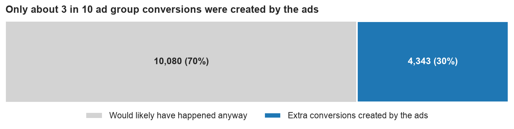

# Marketing A/B Test Analysis: Did the Ad Campaign Work?

An end-to-end analysis of a marketing A/B test with 588,101 users: from data checks and exploratory analysis to a statistical test, business impact and recommendations.

**Tools:** Python (pandas, NumPy, SciPy, statsmodels), SQL (SQLite), Matplotlib, Seaborn, Jupyter Notebook

**[Open the full analysis notebook](marketing_ab_test_analysis.ipynb)**

## Business problem

A company runs an online ad campaign and wants to know whether it is worth the money. Counting how many ad viewers bought the product is misleading, because many of them would have bought anyway. To measure the true effect, the company ran an A/B test:

- **Ad group (treatment, 96% of users):** saw the company's ads.
- **PSA group (control, 4% of users):** saw a public service announcement in the same ad slot.

**Questions answered in this project**

1. Did the ads increase conversions, and is the difference statistically reliable?
2. How many conversions did the ads really create?
3. How much advertising does each extra conversion take?
4. Where did the ads make the biggest difference?

## Key findings

| Question | Answer |
|---|---|
| Did the ads work? | **Yes.** 2.55% of the ad group converted vs 1.79% of the PSA group: +0.77 percentage points (95% CI 0.60 to 0.94), a 43% relative lift, p < 0.001 |
| How many conversions did the ads create? | About **4,300 extra conversions**. Around 70% of the ad group's 14,423 conversions would likely have happened anyway |
| How much advertising per extra conversion? | About **3,200 ad impressions** |
| Where is the effect? | Users who saw **50 to 199 ads** account for about 88% of the estimated extra conversions. No measurable lift below 25 ads (72% of the ad group) or above 200 ads |





## Recommendations

1. **Keep the campaign if one extra conversion is worth more than about 3,200 impressions cost.** At an example price of $5 per 1,000 impressions that is about $16 per extra conversion. The company should plug in its real costs and margin.
2. **Report incremental conversions, not total conversions.** Total conversions overstate the campaign by more than three times.
3. **Keep a small PSA control group running.** It is the only way to measure what the ads add.
4. **A/B test a frequency cap of 200 ads per user.** 1% of users receive 13% of impressions with no measurable lift; a cap would save about 5% of impressions.
5. **A/B test raising exposure for light users towards 50+ ads.** The lift is clearest at 50 to 199 ads, but heavy viewers may simply be more active users, so this needs a test.

## Dataset

[Marketing A/B Testing](https://www.kaggle.com/datasets/faviovaz/marketing-ab-testing) from Kaggle. One row per user.

| Column | Meaning |
|---|---|
| `user id` | Unique user identifier |
| `test group` | `ad` (saw the ads) or `psa` (saw the public service announcement) |
| `converted` | `True` if the user bought the product |
| `total ads` | Number of ads or PSAs the user saw |
| `most ads day` | Day of the week on which the user saw the most ads |
| `most ads hour` | Hour of the day (0 to 23) in which the user saw the most ads |

| Data check | Result |
|---|---|
| Users | 588,101 |
| Ad group / PSA group | 564,577 (96%) / 23,524 (4%) |
| Missing values | 0 |
| Duplicated users | 0 |
| Average ads or PSAs seen | 24.8 in both groups |

## Approach

1. **Data quality checks and cleaning:** missing values, duplicates, invalid values, column names and types.
2. **Exploratory data analysis:** group sizes, distribution of ads seen, conversion by exposure, day and hour, and whether the two groups are comparable.
3. **A/B test:** two-proportion z-test, chi-square test, 95% confidence intervals for the absolute and relative lift, a simulation check and the minimum detectable effect.
4. **Business impact:** incremental conversions and impressions per extra conversion, with example cost scenarios.
5. **Breakdown:** lift by number of ads seen (ad vs PSA within the same exposure band) and a check that the result holds across days of the week.
6. **Recommendations, limitations and next steps.**

## Limitations

- **No cost or revenue data:** the analysis measures extra conversions, not profit. Cost figures are examples.
- **Only the group was randomised:** the overall lift is the strongest result. Breakdowns by exposure, day and hour suggest what to test next but do not prove cause.
- **Small control group:** 4% is enough for the headline result but makes segment-level estimates less precise.
- **Missing context:** the data does not say what the product is, what counts as a conversion or when the campaign ran.
- **Ads vs PSA, not ads vs nothing:** the control group still saw something in the ad slot.

## Repository structure

```text
├── marketing_ab_test_analysis.ipynb   # Full analysis with outputs
├── figures/                           # Charts saved by the notebook
├── outputs/                           # Result tables saved by the notebook (CSV)
├── requirements.txt                   # Python packages
└── README.md
```

## How to run it

1. Download `marketing_AB.csv` from [Kaggle](https://www.kaggle.com/datasets/faviovaz/marketing-ab-testing) and put it in this folder, next to the notebook. The file is not included in the repository.

2. Install the packages (they are already included in a standard Anaconda installation):

   ```bash
   pip install -r requirements.txt
   ```

3. Open the notebook in Jupyter (from Anaconda Navigator, or from a terminal) and choose **Kernel → Restart & Run All**:

   ```bash
   jupyter notebook marketing_ab_test_analysis.ipynb
   ```

## Author

**Lilit Poghosyan**
